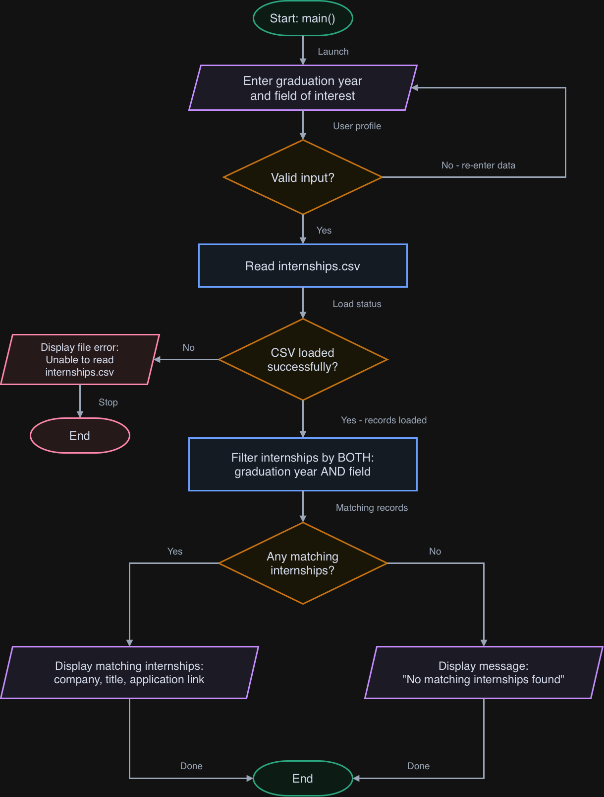

# FreshmanFit

Find internships that match your graduation year and field of interest.

**Status:** Planning stage. The MVP has not been implemented yet.

## The Problem

Students searching for internships have to check individual listings
to see whether they match their graduation year and field of interest.
This process can be time-consuming, especially for freshmen looking
for opportunities open to them.

## How It Works — MVP Scope

The planned MVP will:

- Accept and validate the user's graduation year and field of interest.
- Load internship listings from a prepared local CSV file.
- Filter internships by both graduation year and field.
- Display matching internships with company names and application
  links, or a message if no matches are found.

## Tech Stack

- **Language:** Java.
- **Interface:** Command line.
- **Libraries:** Java standard library; no external dependencies.
- **Data storage:** A local CSV file containing internship listings.
- **Data access:** Local file reading; no external API is required.
- **Development tools:** Java Development Kit and Git.

## Setup

A Java Development Kit will be required to compile and run the MVP.
Compilation and setup instructions will be added and tested
during implementation.

## Usage

Planned interaction:

1. Enter an expected graduation year, such as 2030.
2. Enter a field of interest, such as Software Engineering.
3. View internship listings matching both criteria.

## Roadmap

These features are planned for after the MVP:

- [ ] Save selected internships to a favorites list.
- [ ] Sort matching internships by application deadline.
- [ ] Add filters for location and remote work.
- [ ] Export search results to a file.

## Planning Documents

- [Eisenhower Matrix](docs/eisenhower-matrix.md)
- [System diagram and editable source](docs/)

## Author

[Alisher Usmanov](https://github.com/alisher291)
